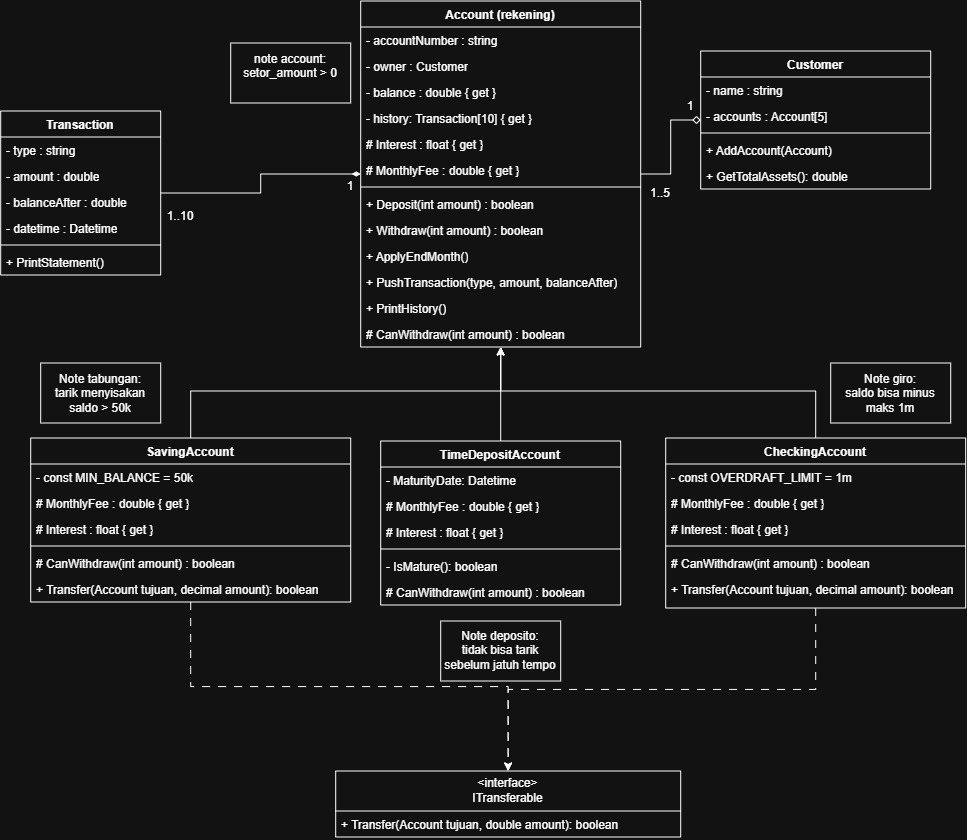

**Kasus 4 - Bank**

Bank menyediakan rekening tabungan, giro, dan deposito. Satu nasabah bisa memiliki lebih dari satu rekening.

Kebutuhan sistem:

* Setiap rekening punya nomor yang tidak bisa diubah, nama pemilik, dan saldo. Saldo hanya berubah lewat setor dan tarik, tidak bisa diisi langsung dari luar class.
* Setor harus lebih dari 0.
* Tarik tabungan menyisakan saldo minimal 50.000. Giro boleh minus sampai batas 1.000.000. Deposito tidak bisa ditarik sebelum jatuh tempo.
* Bunga per tahun: tabungan 2%, giro 0%, deposito 6%, dibayarkan per bulan saat proses akhir bulan.
* Tabungan dan giro bisa transfer ke rekening lain; deposito tidak bisa.
* Setiap rekening mencatat 10 transaksi terakhir.
* Cetak mutasi tiap rekening dan total aset seorang nasabah dari semua rekeningnya.

Fitur Utama:
* **Profil nasabah:** daftar rekening (nomor, jenis, saldo) dan total aset.
* **Setor dan tarik:** saldo baru, atau alasan ditolak (setor 0, saldo minimal tabungan, batas giro, deposito belum jatuh tempo).
* **Transfer:** saldo kedua rekening setelah transfer, atau ditolak jika dari deposito.
* **Mutasi:** 10 transaksi terakhir beserta saldo setelah tiap transaksi.
* **Proses akhir bulan:** bunga tiap rekening dan saldo barunya.
* **Bukti encapsulation:** baris yang mencoba mengubah saldo langsung dari luar class, dibiarkan sebagai komentar karena error compile.

Pembagian:
* **Bagian A - Account:** jenis-jenis rekening beserta aturan tarik dan bunga.
* **Bagian B - Customer & Transaction:** data nasabah dan rekeningnya, transfer, riwayat transaksi, dan proses akhir bulan untuk semua rekening.

Fitur Tambahan: biaya admin bulanan yang berbeda per jenis rekening.

